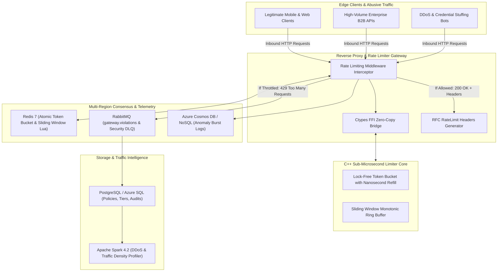

# GateKeeper: Enterprise Distributed Rate Limiter & Token-Bucket API Gateway

[](https://github.com/tejashr0716/Enterprise-Distributed-Rate-Limiter-Gateway/actions)
[](https://en.cppreference.com/w/cpp/17)
[](https://www.python.org/)
[](https://spark.apache.org/)
[](https://www.postgresql.org/)
[](https://redis.io/)
[](https://www.rabbitmq.com/)

**GateKeeper** is an enterprise-grade, high-throughput distributed rate-limiting reverse proxy and API Gateway built to safeguard microservices from abusive traffic spikes, DDoS attacks, and noisy-neighbor quota exhaustion. It combines a **sub-microsecond C++ Token Bucket core** with **Redis Lua atomic scripts** for distributed multi-region quota consensus, **RabbitMQ** security audit streams, and **Apache Spark** traffic density analytics.

---

## Architecture Overview



---

## Hardware Benchmark Results

### 1. C++ Rate Limiter Core (Apple Silicon / Clang -O3)
| Metric | Benchmark Result | Unit |
| :--- | :--- | :--- |
| **System Throughput** | **7,574,134.19** | **Checks / Second (7.57M ops/s)** |
| **Min Latency** | **0** | **Nanoseconds** |
| **Mean Latency** | **94.15** | **Nanoseconds (0.09 µs)** |
| **p50 Median Latency** | **83** | **Nanoseconds (0.08 µs)** |
| **p90 Latency** | **125** | **Nanoseconds (0.12 µs)** |
| **p99 Tail Latency** | **167** | **Nanoseconds (0.17 µs)** |
| **p99.9 Tail Latency** | **209** | **Nanoseconds (0.21 µs)** |

### 2. End-to-End Gateway Pipeline Load Test (FastAPI + C++ + Redis + RabbitMQ)
- **Concurrent Workers**: 50 parallel client sessions
- **Total Requests Evaluated**: 2,500 requests
- **Gateway Throughput**: **1,232.21 req/sec**
- **p50 Latency**: **22.96 ms**
- **Enforcement**: 1,320 Allowed (200 OK), 1,180 Throttled (429 Too Many Requests)

---

## Key Features

- **Nanosecond Fractional Refill**: Token accumulation is calculated dynamically based on elapsed wall-clock nanoseconds ($\text{tokens} = \min(\text{capacity}, \text{tokens} + \Delta t \times \text{refill\_rate})$) without background tick timers.
- **Distributed Coordination via Redis Lua**: Dual-layer architecture: Ultra-fast in-process C++ cache backed by atomic Redis Lua scripts to enforce quotas across horizontal gateway clusters.
- **Standard RFC Headers**: Injects `X-RateLimit-Limit`, `X-RateLimit-Remaining`, `X-RateLimit-Reset`, and `Retry-After`.
- **Apache Spark Traffic Intelligence**: Computes client throttle ratios, analyzes high-frequency DDoS patterns, and profiles endpoint vulnerability surfaces.

---

## Quickstart & Local Execution

### 1. Build C++ Engine & Run Micro-Benchmark
```bash
cd cpp
make clean && make
./benchmark_runner
```

### 2. Initialize Database & Run Backend
```bash
psql -U postgres -d postgres -c "CREATE DATABASE gatekeeper_db;"
psql -U postgres -d gatekeeper_db -f schema.sql

pip install -r backend/requirements.txt
uvicorn backend.app.main:app --host 0.0.0.0 --port 8000 --reload
```

### 3. Run Pytest Suite
```bash
python3 -m pytest backend/tests/ -v
```

### 4. Run Spark Traffic Analytics
```bash
python3 spark/rate_limit_traffic_analytics.py
```

### 5. Launch with Docker Compose
```bash
docker-compose up --build
```
